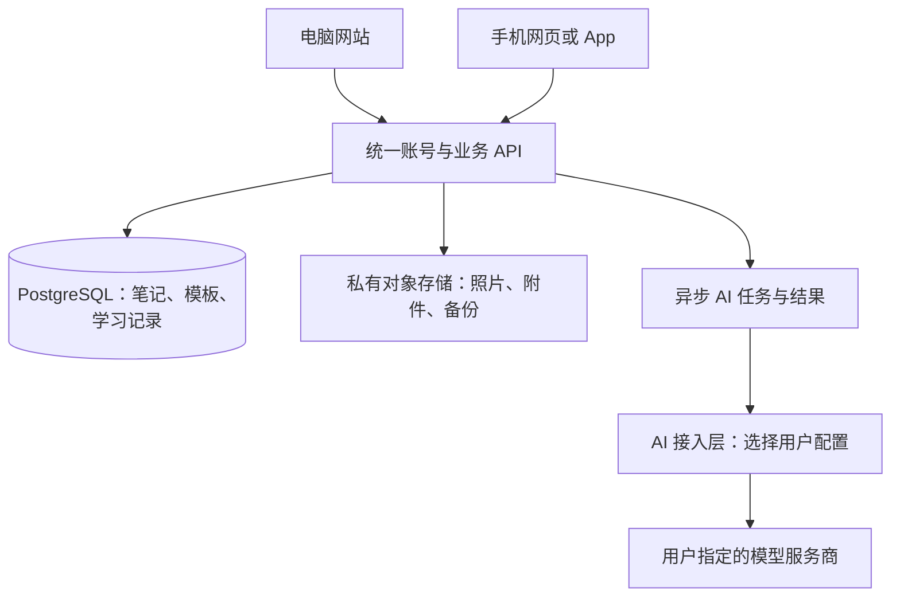

**云服务、跨端同步与 AI API 设置方案 v0.1**

日期：2026-10-22。状态：选型与需求补充，尚未购买、部署或进行性能测试。

已确认：主要服务中国大陆用户；先供本人和少数同学试用；网站与手机必须同步；AI 功能必须能够设置 API；暂不讨论 miniapp。手机端最终采用何种形态，不影响本方案的统一后端原则。

**1. 当前建议**

建议先采用“腾讯云轻量应用服务器 + COS 私有对象存储 + PostgreSQL + 独立 AI API 接入层”。阿里云轻量应用服务器 + OSS + PostgreSQL 是同类可行备选。服务器厂商和模型厂商无需相同。

这是针对小规模试用、可导出和可迁移目标的工程建议，不代表腾讯云在所有场景都优于其他厂商，也不是已经完成的容量测试。

网站与手机共用同一套账号、数据和后端。云服务器提供运行环境；同步逻辑、冲突处理、权限和备份仍需由产品实现。

**2. 具体购买什么**

| 项目 | 起步建议 | 用途与边界 |
|---|---|---|
| 云服务器 | 腾讯云 Lighthouse，Linux，2 核 4GB 内存起步；若符合活动资格，也可选 4 核 4GB | 运行业务服务、数据库和少量后台任务；模型推理由外部 API 承担 |
| 系统盘 | 约 60–100GB SSD | 程序、数据库、日志和临时文件；原始照片主要进入对象存储 |
| 公网带宽 | 普通套餐可从 5Mbps 档比较；3Mbps 活动档可用于低并发试用 | 图片授权后直传对象存储，仍需实测网站首屏和 API 响应；峰值带宽不是持续独享速率承诺 |
| 地域 | 靠近主要用户的大陆地域；例如华东选上海/南京，华南选广州 | 数据库和对象存储优先与业务服务同地域 |
| 对象存储 | 腾讯云 COS 标准存储、私有桶，按量开始 | 照片、错题图片、附件、导出包；存储、请求、外网下行和备份均需计入费用 |
| 数据库 | 小范围试用可先在同机部署 PostgreSQL | 控制初期费用；需要自己维护升级、监控、备份与恢复 |
| 域名及 HTTPS | 一个域名，配置 HTTPS 与证书自动续期 | 网站与 API 的稳定入口 |
| 备份 | 数据库备份保存到服务器之外，定期恢复验证 | 同盘复制不能应对整台服务器故障；同步不等于备份 |
| 模型 API | 可由管理员配置，也允许用户配置自己的凭证 | 单独计费，选择能够从部署地域正常调用的服务 |

首批少量用户且不自托管大模型时，2 核 4GB 是合理的试验起点，不是并发容量保证。上线后根据内存、数据库耗时、AI 任务积压和出流量调整。前端构建尽量在开发环境或 CI 完成，再部署产物。

首版暂不必购买 GPU、Kubernetes、独立向量数据库、复杂负载均衡或多台业务服务器。也不必为网站和手机各买一套后端。

同机数据库的限制是单机故障会同时影响网站与数据库。应明确可接受的恢复时间和数据损失窗口；每日一次备份意味着最坏可能损失上次备份后的修改。若无法接受，需提高备份频率、增加日志归档或选用满足恢复目标的托管数据库方案。

**3. 当前价格与购买条件**

截至 2026-10-22 查到的官方公开信息如下，实际价格仍以账号、地域、可售库存与订单页为准：

| 方案 | 官方展示信息 | 使用时要区分什么 |
|---|---|---|
| 腾讯云新用户活动 | 4 核 4GB、3Mbps，首年 109 元 | 是有资格条件的产品新用户活动，不保证你的账号可买；不是长期续费价 |
| 腾讯云普通入门套餐 | 价格总览列出 2 核 4GB、60GB SSD、5Mbps、500GB/月流量，65 元/月 | 是公开月价口径，不是账号专享优惠；需查看最终订单 |
| 腾讯云普通通用套餐 | 2 核 4GB、100GB SSD、7Mbps，价格总览写 90 元/月，产品页写 100 元/月 | 官方页面存在报价差异，不据此承诺准确成交或续费价 |

来源：[腾讯云活动及规则](https://cloud.tencent.com/act/pro/lhsale)、[价格总览](https://cloud.tencent.com/document/product/1207/73452)、[产品页](https://cloud.tencent.com/product/lighthouse)。

活动页还明确写到该活动实例不支持调整配置，续费按届时适用规则。因此，若选活动套餐，后续扩容要按可能迁移到新实例来设计，不能承诺原地升级。

购买建议：先看账号能否拿到适合的 4GB 内存活动套餐；若没有，再比较 2 核 4GB 的普通套餐。未有性能数据前不建议为 CPU 数量或峰值带宽过度付费。

除服务器外，还需计入域名、对象存储、流量、备份、可能使用的短信和 AI API。这里不把单台服务器活动价当作整个产品的全年成本。

大陆公开部署要安排备案。按腾讯云当前接入条件，通过轻量服务器申请备案要求大陆包年包月资源，购买时长累计至少 3 个月，备案期间剩余有效期至少 1 个月；同时满足公网 IP 和带宽条件。来源：[备案云资源](https://cloud.tencent.com/document/product/243/18908)。因此，不建议为了先试一个月而购买一个不符合备案条件的订单后再补手续；本地原型可以先做，准备部署时一并核对域名、主体和资源条件。

**4. 厂商与托管方式的选择**

- 腾讯云方案：Lighthouse + COS；按上面的初始配置进行预算和部署。推荐原因是本项目需要的常规资源齐全、已有公开可核对套餐，且可保持自己的数据库与 API。
- 阿里云备选：轻量应用服务器 + OSS；同样可运行业务服务和 PostgreSQL。其官方规格包含 2 核 4GB 与 4 核 8GB；不能只比较广告中的最高峰值带宽，还要核对实例性能、系统盘和费用条件。来源：[阿里云实例规格](https://help.aliyun.com/zh/simple-application-server/product-overview/instance-families/)。
- 若希望减少系统运维，可另评估托管后端与托管数据库。它们可能减少机器维护工作，但权限、导出、业务规则、费用控制和同步冲突仍需设计。选择托管方案时应重新核对地域、模型网络访问、存储计费和迁移成本，不与自建方案重复购买。

优先确定一种部署方式，再采购资源。是否已有某家云账号、熟悉哪家控制台、最终订单和续费价格，都可以改变这两个厂商的排序。

**5. “网站与手机同步”的具体含义**

| 数据 | 同步要求 |
|---|---|
| 账号 | 同一用户的不同设备对应同一个内部 user_id；登录方式可绑定，不能各建一个孤立账号 |
| 笔记与公式 | 正文、LaTeX、内容条目 ID、修订版本同步 |
| 图片与附件 | 上传状态、对象 ID、关联条目同步；可重试失败上传 |
| 学习状态 | 当前步骤、暂停/恢复、完成时间和历史事件同步 |
| 疑点与题目 | 不熟悉标记、疑点状态、错题/好题、心得与尝试记录同步 |
| 模板与布局 | 模板版本、书架排序和画布布局同步；个人设备显示方式可单独保存 |
| AI 设置 | 配置名称、服务地址、模型及能力映射同步；密钥留在服务端，另一端显示已配置而不下载明文 |

建议首版以在线同步为主，配本地草稿保护。界面明确显示“保存中 / 已同步 / 离线待同步 / 存在冲突”。

必须实现的机制：

1. 每条记录有稳定 ID 和版本号。手机拿着旧版本保存时，服务端检查版本差异，不直接覆盖电脑的新内容。
2. 发现冲突时保留双方内容，让用户选择或合并；首版不需要承诺任意 Markdown 的自动无损合并。
3. 上传与提交使用请求唯一标识，断网重试不能生成两份例题、两个 AI 任务或重复完成事件。
4. 在线保存成功后可通知另一端刷新，重新打开应用也能拉取增量。实时通知只是提示，服务端已保存的数据才是依据。
5. 删除保留回收记录，避免离线设备重新上传旧内容使已删除条目复活。
6. 同一学习实例只允许一个活动计时会话；另一端可以明确接管。秒级显示由起止时间计算，不需要每秒上报。
7. AI 整理在服务端作为异步任务运行，手机关闭页面不等于取消任务；重新打开可以继续查看状态和结果。

首版不承诺完整离线、多设备同时编辑、多人实时协作；这些与“在线跨端同步”是不同的开发范围。断网草稿和失败重试则应进入首版。

图片使用私有桶；后端确认权限后生成短时上传/下载授权，让客户端直接访问对象存储。不要将永久对象存储密钥放入客户端。来源：[COS 授权访问说明](https://intl.cloud.tencent.com/zh/document/product/436/14116)。

**6. AI API 设置页：明确进入首版**

建议页面入口：“设置 → AI 服务”。用户可以保存多组连接，例如“照片识别”“数学讲解”，并为每类功能指定默认连接。

| 设置项 | 产品要求 |
|---|---|
| 配置名称 | 用户可自定义，方便识别用途 |
| 接口协议 | 首版支持明确约定的 OpenAI 兼容聊天接口；供应商原生等其他协议通过独立适配器扩展，不承诺任意接口都自动可用 |
| Base URL | 用户填写服务根地址；提示是否包含 API 版本路径；程序统一拼接，避免重复添加路径 |
| API Key | 输入后加密保存，只显示遮罩；支持替换、撤销、删除 |
| 模型 ID | 可手动填写；服务商支持时再提供拉取列表，不把列表接口当成必要条件 |
| 模型能力 | 区分文字、图片输入及其他能力；结合测试验证，不仅依赖名称猜测 |
| 功能映射 | 分别指定照片转写、笔记整理、疑点讲解、出题/反馈使用哪组配置 |
| 高级参数 | 超时、最大输出长度、模型支持的采样参数；不支持的参数不盲目发送 |
| 测试连接 | 由实际部署后端发起最小测试，显示鉴权、文本和图片能力结果；测试也可能产生少量供应商费用 |
| 费用和限额 | 显示调用次数与可获取的 token 用量；设置本应用调用额度/预算提醒，金额未获供应商账单时标为估算 |

配置时不能只提供一个 API Key 输入框。接口地址、协议、模型以及是否支持图片，会共同决定调用是否成功。

例如阿里云百炼官方说明可以用兼容接口，通过 API Key、Base URL 和模型名称调用；地域对应的地址也有区别。该例用于说明适配方式，具体默认模型和地址应在接入时按供应商文档配置，不把某个现成字符串写死为所有用户的设置。[百炼官方说明](https://help.aliyun.com/zh/model-studio/what-is-model-studio)。

“OpenAI 兼容”描述的是请求格式，不能推导出供应商相同、所有功能相同或模型具备图片能力。

**7. 不同 AI 功能可以选择不同模型**

| 功能 | 最低能力与验证重点 |
|---|---|
| 课堂照片转写 | 支持图片输入或专用 OCR；检验符号、公式、页序与原图关联 |
| 笔记整理 | 接收校正文本，按约定结构整理；输出字段和公式需检查 |
| 数学解疑 | 根据当前题目与用户尝试讲解；需验证推导质量 |
| 检测题与反馈 | 生成条件充分的题目，保留答案核验步骤；不能只检查能否返回一段文字 |

一个模型满足全部任务时可以共用一组配置；也允许按用途拆开。第一版先用真实数学样本测试模型，之后再选择默认值。

**8. 用户自带 Key 与系统默认 Key**

建议同时支持两种模式，具体默认模式待产品设置确定：

- 系统默认：管理员配置服务，试用用户按分配额度调用，AI 账单归管理员的供应商账号。
- 用户自带：用户提供自己的服务地址和 Key，调用归该 Key 所属供应商账号；网站的服务器和图片存储费用仍由产品运营方承担。

每次调用应能明确使用哪个配置。不因用户 Key 失效就暗中改用管理员付费 Key，也不自动把资料发送给另一供应商；需要回退时由用户预先选择范围。

调用链为“客户端提交学习任务 → 后端验证账号与额度 → 读取该用户授权配置 → 调用模型 → 保存结果”。密钥只在首次提交时通过 HTTPS 传给服务端，后续客户端以配置 ID 使用。

密钥加密保存，解密主密钥与数据库分开管理；业务日志、错误提示和普通学习资料导出均不包含明文密钥。向用户明确说明这是一种由本系统后端代为调用的方式，并非服务器无法接触密钥的端到端加密。

自定义地址应限制为经校验的公网 HTTPS 地址，阻止内部网络、云元数据等地址，以及通过重定向绕过检查。首版不把用户电脑的 localhost 当作云端可访问模型地址；若以后支持本地模型，需要另做受控连接方案。

API 选型应检查从大陆部署地域能否正常访问，以及供应商是否支持对应使用地域。API 地址可编辑并不保证任意服务都可连通。

**9. 开发与采购顺序**

1. 将“大陆为主、网站手机同步、可配置 AI API”写入首版需求与验收。
2. 先在本地做账号、笔记保存、图片上传和 API 配置的最小版本；准备域名与部署方案。
3. 比较最终订单的实例规格、地域、续费与备案条件，再购买一套服务资源；本次仅提出方案，不执行购买。
4. 部署同一套后端、数据库和私有附件存储，完成 HTTPS、备份和恢复验证。
5. 用电脑和手机登录同一账号，验证修改、上传、计时接管、断网和冲突。
6. 从部署服务器测试至少一组文字模型与一组图片能力，落实 API Key 隔离和费用归属。
7. 邀请少数同学试用，根据真实数据决定升级机器、迁移托管数据库或扩展移动端能力。

**验收例子**：手机拍照后电脑能看到同一份资料；电脑标记疑点后手机能继续；两端同时修改不会静默丢内容；手机结束计时后电脑不会继续累加；换一个有效 AI 服务配置后对应功能可以正常调用；普通导出包中没有密钥；数据库备份可以恢复。
